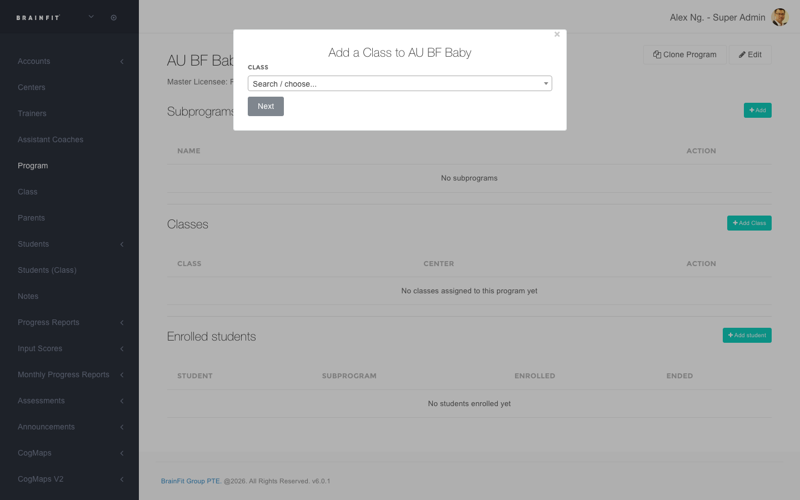

This feature is for SA, ML, Master Admin, Center Admin

Attaching a Class to a Program is what actually puts students **into** that Program — there's no separate
step where you individually enroll every student in a class. This page explains exactly what happens when
you do this, since it's not obvious from the screen alone.

## Adding a Class

1. **Navigate** to the [ACP](https://acp.brainfitstudio.com/acp) → **Program**, and open the Program you
   want to add a class to.

2. In the **Classes** section, click **Add Class**.
3. A window opens — search for or choose the class, then click **Next**.

4. Once added, the class appears in the **Classes** table, and its students appear in **Enrolled students**
   automatically (see below for exactly how).

To remove a class later, use the remove action next to it in the **Classes** table.

## What happens automatically when you add a class

- **Every student currently in that class is enrolled in the Program immediately** — enrolled date is set to
  the day you added the class. You don't need to add students one by one.
- No Subprogram is set automatically — enrollments from adding a class always land with no Subprogram. If you
  need students in a specific Subprogram, that has to be set per-student separately (Super Admin only — see
  the note below).
- If a student is already actively enrolled in that Program (e.g. from a previous class), they're **not**
  double-enrolled — adding the class again is safe.

## This keeps working after the class is added — not just a one-time action

**Moving a student to a different class automatically updates their Program enrollment too**, at any time
after the class was first attached — not just when you click "Add Class":

- If a student is moved **into** a class that belongs to a Program, they're enrolled in that Program right
  then, the same way as above.
- If a student is moved **out of** a class that belongs to a Program, their enrollment in that Program is
  ended (dated that day) — *unless* they're still in another class that's also attached to the same Program,
  in which case nothing changes.

So once a class is attached to a Program, you can manage it going forward just by moving students between
classes as usual — Program enrollment follows along on its own.

## Removing a class from a Program

Its students' enrollments in that Program are **ended** (not deleted — the enrollment record stays, just
marked with an end date), again unless a student is still in another class also attached to that same
Program.

## A class can belong to more than one Program

A single class isn't limited to one Program — if you attach the same class to two different Programs, its
students get enrolled in **both**. Likewise, one student can be actively enrolled in several different
Programs at the same time (just never two *active* enrollments in the *same* Program at once).

## Where to see a student's Program enrollment

There's currently **no Program information shown on a student's own profile page**, and no link to it from
anywhere in the student's normal pages. The only place enrollment history (Program, Subprogram, enrolled/
ended dates) is listed per-student is a **Super Admin-only** screen — if you're ML/MA/CA, you can attach
classes and see who's enrolled from the **Program**'s own page (as above), but not from the student's side.
