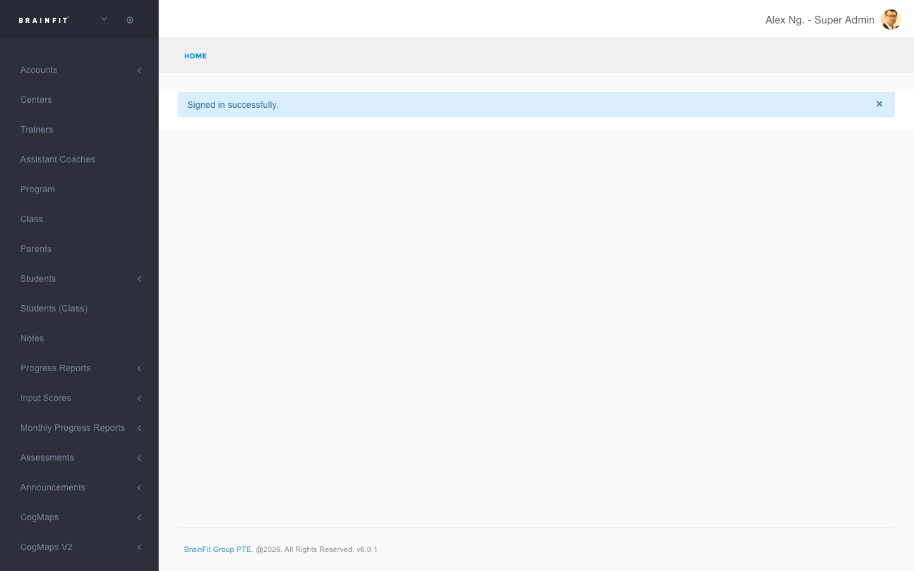
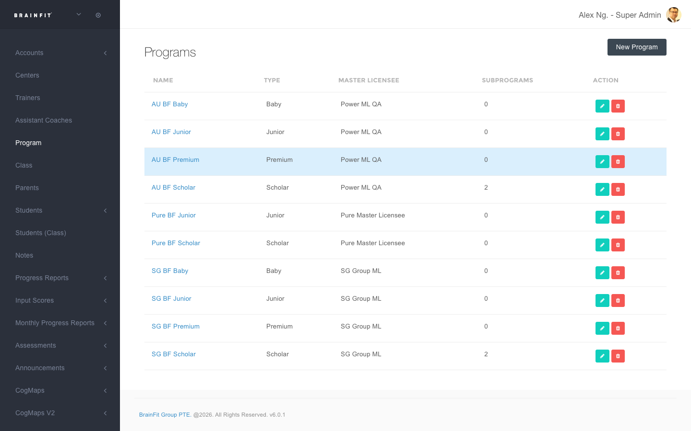
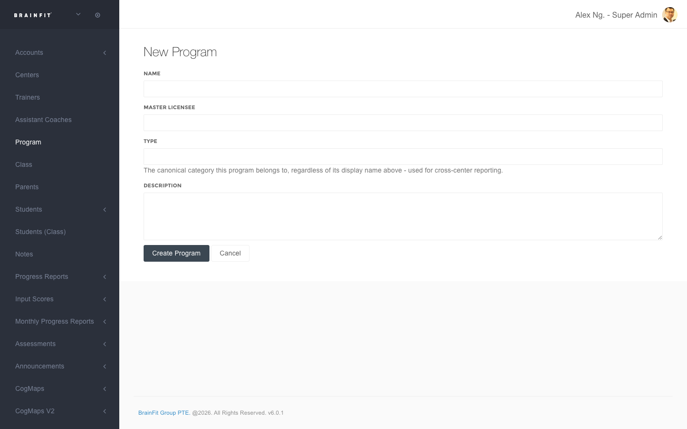
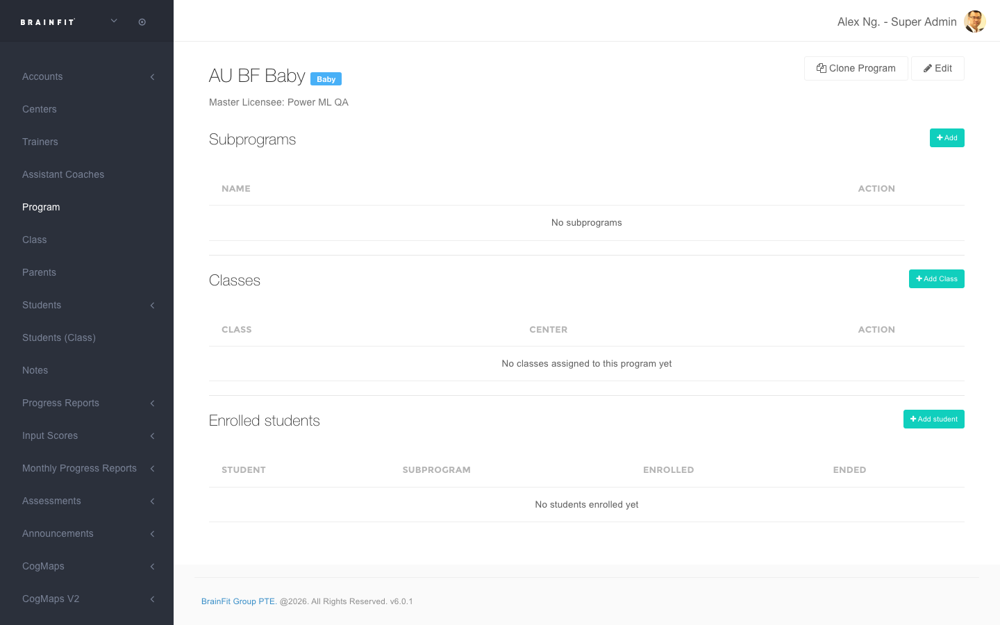

This feature is for SA, ML, Master Admin, Center Admin

## What is a Program?

A **Program** is how a Master Licensee organizes their offering — for example "AU BF Junior" or "SG BF
Scholar". Each Program belongs to exactly one Master Licensee, and has a **Type** (a fixed category: Junior,
Scholar, Baby, or Premium) used for cross-center reporting regardless of what the Program is actually named.

Programs are used to:
- Track which students/classes are enrolled in which Program.
- Get attached to **Assessment Templates**, which controls the branded header ("BrainFit Junior", "BrainFit
  Scholar", etc.) on printed Assessment Report Card PDFs — see
  [Assessment Print-Out](../Assessment_PrintOut/download-assessment-report-card.md) and the note in
  [Managing Assessment Templates](../Assessment_Tracker/manage-template-assessment.md).

**Each Master Licensee (and their Master Admin / Center Admin) only ever sees and manages their own
Programs** — never another Master Licensee's.

## Viewing your Programs

1. **Navigate** to the [ACP](https://acp.brainfitstudio.com/acp).
2. Find **Program** in the navigation menu (a standalone item, not nested under anything else).

3. You'll see a table of all Programs you have access to, with their **Type**, **Master Licensee**, and
   **Subprograms** count.

## Creating a New Program

1. From the Programs list, click **New Program**.
2. Fill in the following fields:
   * **Name:** A display name for the Program (e.g. "SG BF Scholar").
   * **Master Licensee:** Which Master Licensee this Program belongs to. If you're a Master Licensee,
     Master Admin, or Center Admin, this is locked to your own organization — you won't see other MLs here.
   * **Type:** One of **Junior**, **Scholar**, **Baby**, or **Premium** — the canonical category used for
     cross-center reporting, and what actually appears on printed Assessment Report Card PDFs (as
     "BrainFit `Type`"), separately from the Name above.
   * **Description:** Optional free text.

3. Click **Create Program**.

## Viewing / Editing a Program

Click a Program's name from the list to open its detail page. From here you can:

- **Edit** the Program's Name, Master Licensee, Type, or Description.
- **Clone Program** — copies this Program (and its Subprograms) to a different Master Licensee, so a new ML
  running the same kind of program (e.g. another "Scholar") gets their own separate record instead of sharing
  this one. **Super Admin only** — this action explicitly reassigns to a different ML, so it's not
  self-service for ML/MA/CA.
- Manage **Subprograms**, **Classes** attached to the Program, and **Enrolled students** — adding a class here
  automatically enrolls its students in the Program. See
  [Adding a Class to a Program](./attach-class-to-program.md) for exactly what this does and how it keeps
  working afterward as students move between classes.

## Relationship to Assessment Templates

A Program is **manually attached** to an Assessment Template (there's no automatic matching by name, and no
bulk backfill) — see [Managing Assessment Templates](../Assessment_Tracker/manage-template-assessment.md) for
how to set the Program field on a template. Once a template has a Program assigned, its printed report cards
show that Program's Type in the header instead of the generic default — see
[Assessment Print-Out](../Assessment_PrintOut/download-assessment-report-card.md).
